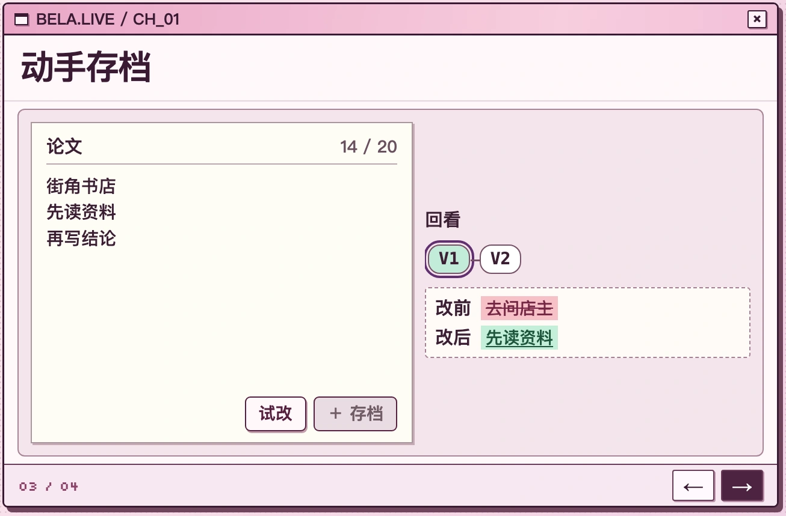
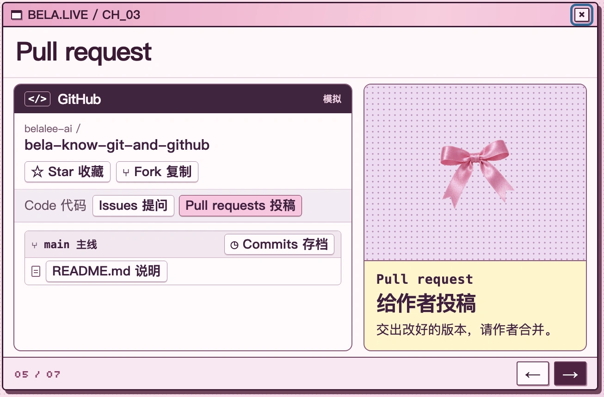
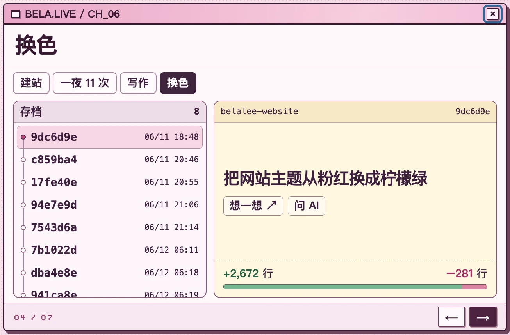

# Bela OS · 文科生也能懂的 Git & GitHub

如果导师现在要你交上周三那版论文，你能从一堆「最终版」里把它找出来吗？

李贝拉Bela 把这个问题做成了一张可以玩的粉色电脑桌面。打开「论文时光机」，改一句、存一版，再亲手翻回去，就能看懂 Git 怎样记住修改。接着逛一个模拟的 GitHub 仓库，看看别人如何收藏作品、提问题、给作者投稿。六节节目都能独立打开，适合自己试，也适合直播投屏。

**[下载完整项目 ZIP][main-zip]**　·　[浏览首页源码](index.html)


## 怎么运行

1. **[下载并解压整个 ZIP][main-zip]。** 网页、字体、图片和演示数据都在同一个文件夹里。
2. **双击 `index.html`。** 浏览器会打开 Bela OS。全程可以断网，无需安装软件包或启动服务器。
3. **按 `1` 试一次存档。** 进入「论文时光机」，用 `→` 翻到「动手存档」，改一句、点「存档」，再点旧版本看差异。按 `Esc` 关掉当前窗口。

直播时可在第二块屏幕打开 `notes.html` 看提词卡，让 OBS 或直播伴侣采集主屏。主画面按 1920 × 1080 设计，右下角给摄像头留了位置。

<details>
<summary>用 Git 获取完整项目</summary>

```sh
git clone https://github.com/belalee-ai/bela-know-git-and-github.git
cd bela-know-git-and-github
```

默认分支 `main` 包含完整网页、素材和数据。在刚克隆的目录里双击 `index.html` 即可。

</details>

## 三个可以亲手试的场景

| 第 1 节 · 给论文存个档 | 第 3 节 · 给作者投个稿 |
| --- | --- |
|  |  |
| 点回 V1，看看刚改的那句话原来怎么写。 | 点 **Pull requests 投稿**，看看改完自己的副本后，怎样请原作者收下修改。 |

### 第 6 节 · 翻开我的 28 次真实存档

在第四章「换色」点开 `9dc6d9e`，就能看到个人网站从粉红换成柠檬绿的那次修改，以及增加、删去了多少行。这里用的是李贝拉Bela 做个人网站时真正留下的记录。



桌面上的另外三个节目是「平行宇宙」「开源名人堂」和「AI 后悔药」。你可以给同一篇论文试两个标题，看一个开源作品有多少人参与，或者把 AI 改坏的页面恢复到刚才能用的那一版。

## 直播快捷键

| 按键 | 作用 | 按键 | 作用 |
| --- | --- | --- | --- |
| `1`–`6` | 直接进入对应节目 | `←` / `→` | 上一步 / 下一步 |
| `L` | 放大 30 秒循环回顾 | `T` | 打开术语翻译机 |
| `Q` | 打开本节弹幕小测 | `N` | 打开独立提词卡 |
| `Esc` | 关闭当前窗口 | `0` | 回到桌面 |

<details>
<summary>维护项目与验证离线运行</summary>

项目使用 HTML、CSS 和原生 JavaScript。章节与投票题在 `js/programs.js`，主播讲词在 `js/notes.js`。维护者和开发助手从 [AGENTS.md](AGENTS.md) 或 [CLAUDE.md](CLAUDE.md) 进入。直播要求见[网页任务书](docs/brief.md)，案例和数字见[数据来源](docs/sources.md)。

在完整项目目录运行以下检查。检查工具使用 Node.js 22 或更高版本和本机 Chrome / Chromium，可用 `CHROME_PATH` 指定浏览器路径。

```sh
node scripts/check-offline.mjs
node scripts/shoot.mjs
node scripts/shoot.mjs --tour
```

截图输出到 `shots/`。完整的交互复核记录见[交付说明](BUILD_NOTES.md)。

</details>

[main-zip]: https://github.com/belalee-ai/bela-know-git-and-github/archive/refs/heads/main.zip
