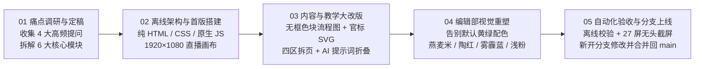
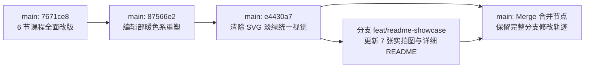
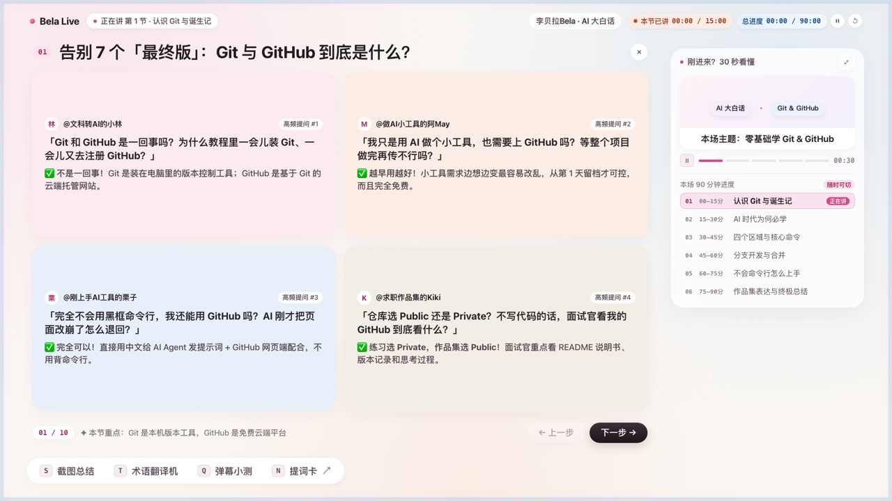
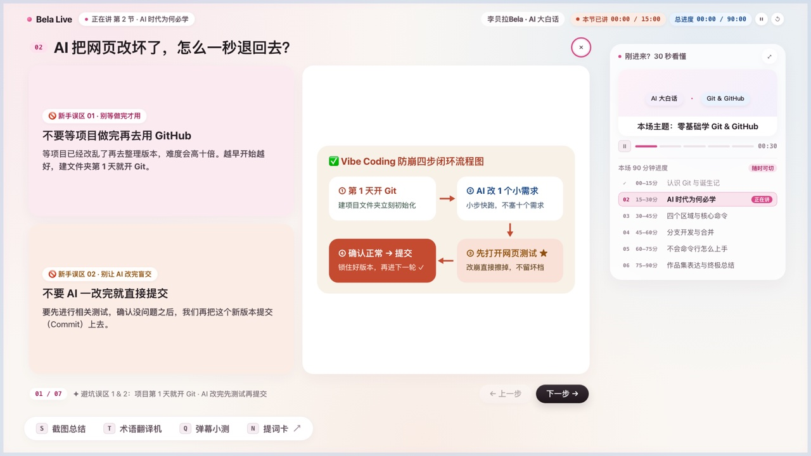
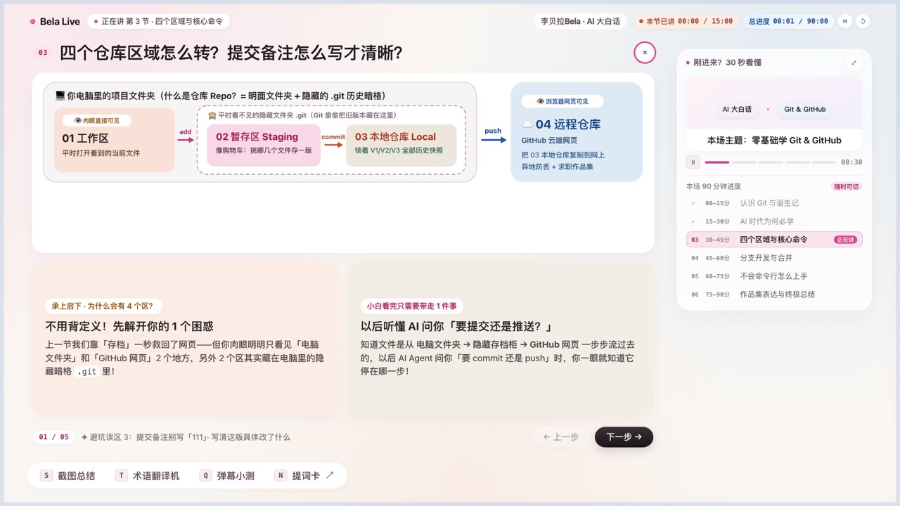
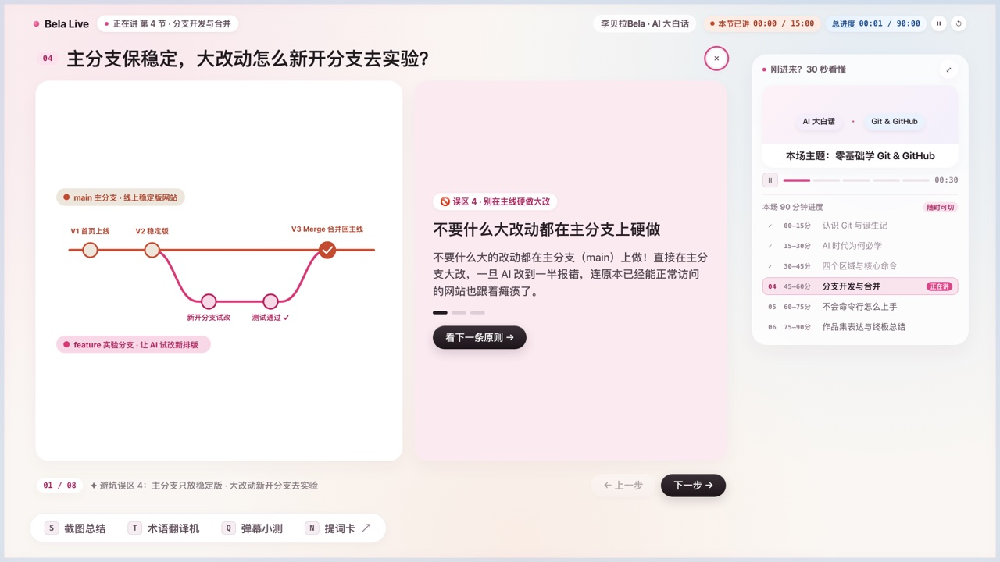
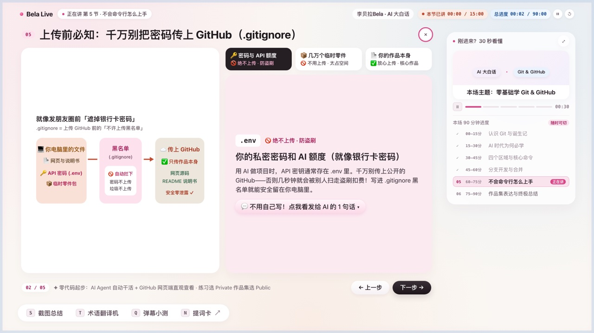
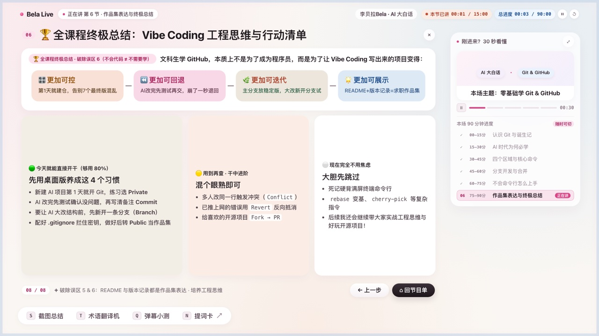

# Bela Live · 文科生也能懂的 Git & GitHub

> **李贝拉Bela · AI 大白话** 90 分钟互动直播课网页 —— 纯本地离线运行，双击 `index.html` 即可开讲与实操。


用 **AI Agent 工具** 做小工具、搭个人主页时，新手最怕两件事：一是改到第 5 版把第 3 版弄崩、再也退不回去；二是面对黑框命令行和满屏英文术语，不知道从哪下手。

**Bela Live** 就是为 **0 代码基础、正在用 AI Agent 做项目** 的同学打造的互动教学桌面：没有枯燥 PPT，也没有服务器依赖。从网友最常问的 4 个真实痛点出发，用马卡龙便利贴与无框色块流程图，一步步带你打通 **Git 本地版本管理 → AI 改崩一秒退回 → 四区透视图与命令流转 → 分支开发与合并 → 零命令行上手 → 求职作品集表达**。

**[下载完整项目 ZIP][main-zip]**　·　[浏览首页源码](index.html)　·　[查看完整提交记录][commits-url]　·　[查看演示分支 `feat/readme-showcase`][branch-url]

---

## 目录导航

1. [这个项目是怎么一步步做出来的？（完整搭建与迭代流程）](#一这个项目是怎么一步步做出来的完整搭建与迭代流程)
2. [全新改版界面一览（6 大核心页面实拍）](#二全新改版界面一览6-大核心页面实拍)
3. [90 分钟 6 大课程模块与直播间专属功能](#三90-分钟-6-大课程模块与直播间专属功能)
4. [真实改动与迭代记录（Changelog & 分支演示）](#四真实改动与迭代记录changelog--分支演示)
5. [本地离线运行、双屏提词与快捷键](#五本地离线运行双屏提词与快捷键)

---

## 一、这个项目是怎么一步步做出来的？（完整搭建与迭代流程）

这个仓库本身，就是一次完整的 **「AI Agent 工具 + Git 版本控制 + GitHub 公开展示」** 真实工程示范。整个项目从初版雏形到如今的全面改版，一共经历了 **5 个阶段**：



### 每一步具体做了什么？

1. **阶段 1 · 从零基础真实提问反推课程结构**
   - 不从枯燥的命令行语法开始讲，而是先整理文科生与新手在用 AI 做项目时最真实的 4 个困惑（`Git 和 GitHub 是不是一回事？`、`做完再传不行吗？`、`不会命令行怎么办？`、`不写代码面试官看什么？`），直接放在第 1 节开场。
   - 把 90 分钟拆为 6 个独立模块，每一节都可以中途切入，且每一节最后都固定配一张 **「📸 模块总结卡」** 方便观众截图带走。
2. **阶段 2 · 零依赖纯离线架构**
   - 坚持不使用任何外部 CDN 或构建工具，全部采用原生 `HTML + CSS + JavaScript`，字体、图标和数据全部本地打包。
   - 为 `1920 × 1080` 直播大屏预留右下角 `400 × 300` 摄像头安全区，并在副屏独立提供 `notes.html` 主讲提词器。
3. **阶段 3 · 教学动线深度打磨（本次大改版核心）**
   - **去品牌化 & 降门槛**：全篇不绑定具体编程软件品牌，统一写作 **「AI Agent 工具 + GitHub 网页端」**；在装 Git、配 `.gitignore`、开分支等环节内置「点我看发给 AI 的提示词」。
   - **把抽象概念画成透视图**：第 3 节拆为两页过渡，先用「明面文件夹 vs `.git` 隐藏暗格」透视图讲清为什么会有 4 个区域，再进入 6 命令流转沙盘与 **AI 个人主页** 存档红绿 Diff 实操。
   - **真实数据可视化**：用内嵌 SVG 绘制 Git & GitHub 官方图标、分支分叉合并图，以及 GitHub Octoverse 全球规模与热门开源项目刻度条形图。
4. **阶段 4 · 视觉去「AI 味」，建立编辑部暖色调色板**
   - 彻底清除市面上常见的默认黄绿 / 薄荷绿渐变色块，改用参考独立杂志风格的纯色卡片与柔和留白：**暖燕麦米**、**编辑部浅粉**、**暖陶红**、**雾霾蓝**与**淡丁香紫**。
   - 所有主交互按钮统一为苹果风格无边框微光胶囊，顶部新增真实的 **单节 15 分钟 + 全场 90 分钟直播计时器**。
5. **阶段 5 · 自动化自检 + 真实分支工作流**
   - 每次修改后都会运行 `node scripts/check-offline.mjs`（确认 0 外部请求）与 `node scripts/shoot.mjs`（自动模拟点击 6 个模块、生成 27 张实拍图并检查 0 浏览器报错）。
   - 本次新版 README 与界面展示图，正是通过新建独立分支 `feat/readme-showcase` 完成修改、推送到远端后再合并回 `main` 主分支，完整演练课程第 4 节讲到的分支开发闭环：



---

## 二、全新改版界面一览（6 大核心页面实拍）

以下 6 张截图均由自动化验收脚本在 `1920 × 1080` 画布下直接实拍生成，展示本次改版后的真实上课界面：

| 第 1 节开场 · 4 大网友真实提问墙 | 第 2 节 · AI 时代避坑误区 & 4 步闭环 |
| :---: | :---: |
|  |  |
| **痛点先行**：把新手最不敢问的 4 个高频问题做成卡片墙，先共鸣再拆解。 | **Vibe Coding 节奏**：跑通一点 → 存一个版本 → 再让 AI 继续改，改崩一秒退回。 |

| 第 3 节 · 四区「明面 vs `.git` 暗格」透视图 | 第 4 节 · `main` 主线与 `feature` 分支合并 |
| :---: | :---: |
|  |  |
| **一图打通承接**：讲清平时看得见的文件夹、藏在 `.git` 里的暂存/本地仓和云端的关系。 | **分叉与合并**：主分支永远保持稳定，新功能在实验分支试错，跑通后再合并。 |

| 第 5 节 · `.gitignore` 上传黑名单大白话图解 | 第 6 节 · 终极工程思维收官卡 |
| :---: | :---: |
|  |  |
| **安全红线**：像发朋友圈前遮掉银行卡密码，把 API Key 与缓存自动挡在上传门外。 | **带走行动清单**：总结 6 大核心动作与求职作品集标准，听完就能直接上手实操。 |

---

## 三、90 分钟 6 大课程模块与直播间专属功能

### 课程大纲

| 节次 | 模块名称 | 核心看点与交互演练 |
| :---: | :--- | :--- |
| **01** | **认识 Git 与诞生记** | 网友 4 大真实提问墙 → 7 个「最终版」与 AI 改崩痛点 → Git vs GitHub 官方图标双核流程图 → Linus 10 天起源时间线 → Octoverse 全球规模刻度图 → 📸 模块总结 |
| **02** | **AI 时代为何必学** | 避坑误区 1 & 2（早建仓、先测试再提交）→ AI 改主页改崩一秒退回交互演示 → 三种后悔药（`Discard / Reset / Revert`）决策对比 → 📸 模块总结 |
| **03** | **四个区域与核心命令** | 两页平滑过渡：先看「肉眼可见 vs `.git` 暗格」透视图 → 4 区卡片详解 → 6 大核心命令流转沙盘 → **AI 个人主页** 存档与红绿 Diff 实操（误区 3）→ 📸 模块总结 |
| **04** | **分支开发与合并** | 避坑误区 4（别在主分支硬做大改）→ `main` 与 `feature` 分叉合并 SVG 流程图 + AI 提示词 → 主页标语合并冲突弹幕投票 → 📸 模块总结 |
| **05** | **不会命令行怎么上手** | **AI Agent 工具 + GitHub 网页端** 3 步零命令行起步 → `.gitignore` 上传黑名单大白话图解 → `Private` 练习 vs `Public` 作品集双向同步模拟 → 📸 模块总结 |
| **06** | **作品集表达与终极总结** | GitHub 仓库结构拆解（误区 5：README / Commits / Issues 都是作品集表达）→ 开源协作 4 步流与星标数据图 → 6 大误区 × 4 大 FAQ 总表 → 贝拉建站 28 次真实存档 → 🏆 终极收官 |

### 直播间专属体验

- **实时节拍计时器**：右上角实时显示 `本节已讲 / 15:00` 与 `总进度 / 90:00`，支持随时暂停与重置，超时自动暖红提醒。
- **中途观众 30 秒看懂**：首页右侧常驻纯观众视角的 30 秒自动轮播卡片 + 90 分钟进度路线图，随时进直播间都能跟上节奏。
- **一键展开 AI 提示词**：无需死背命令，把发给 AI Agent 工具的大白话指令直接藏在课堂按钮里，点开就能复制照抄。

---

## 四、真实改动与迭代记录（Changelog & 分支演示）

你可以直接点击下方的 **Commit 编号**，在 GitHub 上逐行查看每一次真实修改，感受「小步提交 + 清晰备注」在实际项目里长什么样：

| 阶段 / 版本 | 提交编号 | 所属分支 | 本次改动做了什么 |
| :--- | :---: | :---: | :--- |
| **v2.2 展示页与分支示范** | *本分支合并提交* | `feat/readme-showcase` → `main` | 新建独立分支，补充完整项目搭建与迭代流程图（Mermaid）、替换 7 张新版 1920×1080 实拍截图、整理真实 Changelog，并保留演示分支供直播展示分叉与合并过程。 |
| **v2.1 视觉去绿与编辑部配色** | [`e4430a7`](https://github.com/belalee-ai/bela-know-git-and-github/commit/e4430a7) | `main` | 彻底清除内嵌 SVG 流程图中的淡绿残留，全站色块统一为暖燕麦米、编辑部浅粉、暖陶红、雾霾蓝与淡丁香紫。 |
| **v2.0.1 调色盘升级** | [`87566e2`](https://github.com/belalee-ai/bela-know-git-and-github/commit/87566e2) | `main` | 替换默认 AI 黄绿渐变色，优化首页便利贴、流程图色块与总结卡的对比度与杂志感排版。 |
| **v2.0 课程体系大改版** | [`7671ce8`](https://github.com/belalee-ai/bela-know-git-and-github/commit/7671ce8) | `main` | 全面重构 6 大模块：第 1 节加入网友 4 大提问墙与 Git/GitHub 官方 Logo；第 3 节拆分为两页并新增四区透视图与 AI 个人主页 Diff 沙盘；第 5 节改为 AI Agent 工具 + GitHub 网页端并重写 `.gitignore`；新增直播计时器与每节 📸 总结卡。 |
| **v1.x 初版桌面与离线基建** | [`d4aebef`](https://github.com/belalee-ai/bela-know-git-and-github/commit/d4aebef) / [`0f6886c`](https://github.com/belalee-ai/bela-know-git-and-github/commit/0f6886c) | `main` | 搭建纯离线 Bela OS 直播桌面、双屏提词器 `notes.html`、离线资源校验脚本与自动化截屏工具。 |

> **给正在看这个仓库的同学一个小彩蛋**：
> 点击仓库左上角的分支下拉框，你会看到除了默认分支 `main` 之外，还保留了一个真实的功能分支 **[`feat/readme-showcase`][branch-url]**。这就是第 4 节里讲到的「在分支上改封面、改完确认没问题再合并回 `main`」的真实案例！

---

## 五、本地离线运行、双屏提词与快捷键

### 3 步本地打开

1. **[下载并解压完整项目 ZIP][main-zip]**（或使用 `git clone https://github.com/belalee-ai/bela-know-git-and-github.git`）。
2. 进入解压后的文件夹，直接 **双击 `index.html`** 在浏览器中打开（100% 纯离线，无需 `npm install`，也无需启动任何服务器）。
3. **双屏直播提词**：按键盘 `N`（或直接双击 `notes.html`）可在第二块屏幕打开主讲提词卡；主屏画布为 `1920 × 1080`，右下角 `400 × 300` 区域已自动避让摄像头。

### 课堂快捷键速查

| 按键 | 功能 | 按键 | 功能 |
| :---: | :--- | :---: | :--- |
| `1`–`6` | 快速切入 6 大课程模块 | `←` / `→` | 上一步 / 下一步 |
| `S` | 弹出本节 / 全场高光截图总结 | `T` | 打开大白话术语翻译机 |
| `Q` | 弹出本节弹幕互动小测 | `L` | 全屏放大 30 秒回顾卡 |
| `N` | 打开副屏主讲提词卡 | `0` / `Esc` | 返回首页 / 关闭当前浮窗 |

---

<details>
<summary>维护者与开发者：目录结构与自动化自检</summary>

### 核心目录

```text
bela-know-git-and-github/
├── index.html               # 1920×1080 直播主屏入口
├── notes.html               # 第二屏主讲提词卡
├── css/                     # 桌面框架、工作台、画廊与编辑部配色样式
├── js/
│   ├── app.js               # 路由、窗口切换、直播计时器与快捷键
│   ├── programs.js          # 6 大节目标题、入场提示、30 秒回顾与弹幕投票
│   ├── notes.js             # 开场白、讲述要点与衔接过渡语
│   ├── lessons-workshop.js  # 第 1–4 节互动模块与 SVG 流程图
│   └── lessons-gallery.js   # 第 5–6 节互动模块、数据图表与终极总结
├── data/                    # 真实建站存档、术语表与 Octoverse 统计快照
├── docs/
│   ├── images/              # README 展示用实拍界面截图
│   └── sources.md           # 数据与案例原始来源记录
└── scripts/
    ├── check-offline.mjs    # 离线资源与 0 外部请求校验
    └── shoot.mjs            # 自动化交互巡检与 27 屏无头截屏
```

### 每次改动前后的标准验收命令

```sh
node scripts/check-offline.mjs
node scripts/shoot.mjs
```

更多协作与验收规则请查阅 [AGENTS.md](AGENTS.md)。

</details>

[main-zip]: https://github.com/belalee-ai/bela-know-git-and-github/archive/refs/heads/main.zip
[commits-url]: https://github.com/belalee-ai/bela-know-git-and-github/commits/main
[branch-url]: https://github.com/belalee-ai/bela-know-git-and-github/tree/feat/readme-showcase
